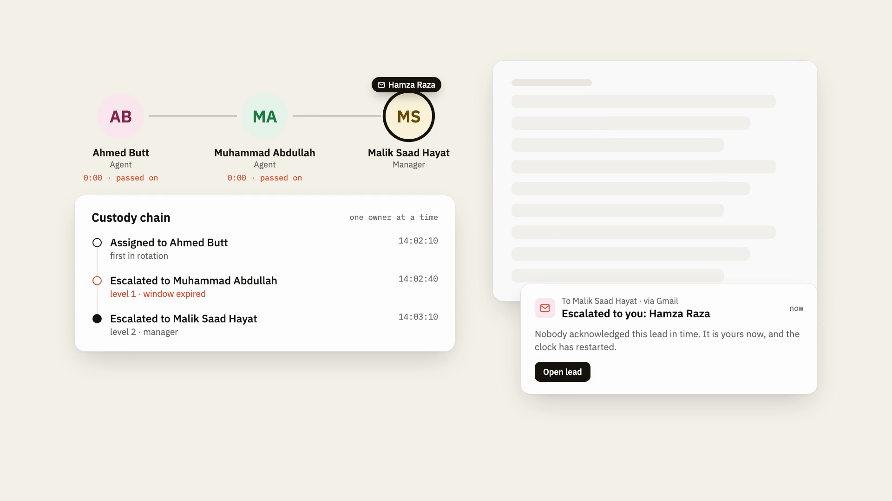
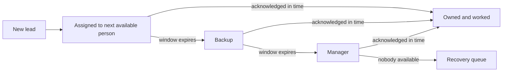
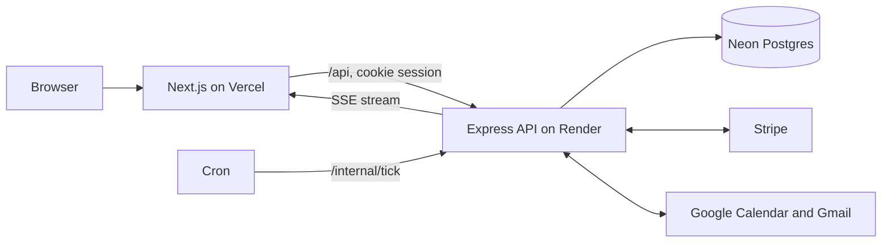

<p align="center">
  <picture>
    <source media="(prefers-color-scheme: dark)" srcset="frontend/public/brand/relay-mark-dark.png" />
    
  </picture>
</p>

<h1 align="center">Relay</h1>

<p align="center">Every lead gets answered. If the owner doesn't reply in time, Relay hands it to the next person automatically.</p>

<p align="center">
  <a href="https://relay-nascon.vercel.app"></a>
  <a href="LICENSE"></a>
</p>

<p align="center">
  <a href="https://github.com/saadhtiwana/relay/releases/download/v1.0/relay-launch-1920x1080-v3.mp4">
    
  </a>
  <br />
  <sub>Watch the 40-second launch video (<a href="https://github.com/saadhtiwana/relay/releases/tag/v1.0">all formats</a>).</sub>
</p>

## Live app

[relay-nascon.vercel.app](https://relay-nascon.vercel.app)

Demo access on request: [abdullahisdev@gmail.com](mailto:abdullahisdev@gmail.com) or [@abdullahxdev](https://github.com/abdullahxdev).

## The problem

- Enquiries arrive on web forms, email and chat, and some never get a reply.
- Nobody owns the follow-up, so everyone assumes someone else has it.
- Managers find out days later, when the customer has already gone elsewhere.

## What it does

- **Response timer with escalation.** Every lead has one owner and a deadline. Miss it and the lead moves on: owner, then backup, then manager.
- **Recovery queue.** Leads that were ignored, escalated twice or left idle, each with the reason.
- **CRM.** Contacts, companies, opportunities and a pipeline board with required fields per stage.
- **Payments.** Stripe payment links, with webhooks verified by signature and deduplicated.
- **Google Calendar and Gmail.** Book without clashes, send invites, and reply to customers from the lead's thread.
- **Alerts.** Email and in-app notifications for assignments and escalations.
- **Roles and permissions.** Owner, admin, user and custom roles. Deal values are masked on the server for people without access.
- **Audit log.** Append-only. The database rejects updates and deletes.
- **Realtime.** Lists, timers and the dashboard update live over server-sent events.

## How the lead engine works



- **Deadlines live in the database.** Each lead row stores its owner, deadline and escalation level, so nothing depends on memory.
- **One hand-off per expiry.** An escalation locks the lead row (`FOR UPDATE`) and writes with a version check. If two sweeps race, one wins and the other rolls back.
- **Restarts lose nothing.** A timer fires at the next deadline, a safety poll runs every 30 seconds, and an external cron calls `/internal/tick`. Leads that came due while the server was down escalate on boot and are marked as late.
- **Work is spread safely.** Sweeps claim due leads with `SKIP LOCKED`, so several instances share the load without colliding.
- **Alerts survive failures.** Escalation emails are written to an outbox in the same transaction and retried with backoff.

Full details are in [docs/lead-engine.md](docs/lead-engine.md).

## Architecture



| Layer | Stack |
|---|---|
| Frontend | Next.js (App Router), React, TypeScript, Tailwind CSS, TanStack Query |
| Backend | Node 20+, Express 5, TypeScript, Zod |
| Database | PostgreSQL on Neon, Drizzle ORM and SQL migrations |
| Integrations | Stripe, Google Calendar, Gmail (OAuth 2.0) |
| Tests | Vitest, Supertest |
| Hosting | Vercel (web), Render (API), Neon (database) |

## Security

- Passwords hashed with Argon2id; repeated bad logins are locked out.
- Server-side sessions in httpOnly cookies, revocable and expiring.
- CSRF protection: state-changing requests must come from an allowed origin.
- Rate limiting on login and the public enquiry form.
- Workspace isolation on every query. Another workspace's record is a plain 404.
- Stored integration secrets encrypted with AES-256-GCM, shown only as the last four characters.
- Append-only audit log, enforced by a database trigger.

## Run it locally

You need Node 20+, npm and a Postgres database (a free Neon branch works).

```bash
git clone https://github.com/saadhtiwana/relay.git
cd relay

# API
cd backend
cp .env.example .env          # fill in DATABASE_URL, SESSION_SECRET, ENCRYPTION_KEY
npm install
npm run migrate
SEED_PASSWORD='choose-your-own' npm run seed   # optional demo data
npm run dev                   # http://localhost:4000

# Web, in a second terminal
cd frontend
cp .env.example .env.local
npm install
npm run dev                   # http://localhost:3000
```

`ENCRYPTION_KEY` is 32 random bytes in base64: `openssl rand -base64 32`. Stripe and Google keys are entered in the app under Settings, Integrations and stored encrypted per workspace. Never commit `.env` files.

## Repo layout

```
backend/    Express API: core (auth, rbac, audit, outbox, scheduler, realtime) and modules (leads, crm, payments, ...)
frontend/   Next.js app: routes in src/app, one folder per feature in src/features
docs/       API, schema, modules and lead engine
video/      Remotion source for the launch video
```

The API reference, schema and module guide are in [docs/](docs/).

## Team

- Muhammad Abdullah ([@abdullahxdev](https://github.com/abdullahxdev))
- Malik Saad Hayat ([@saadhtiwana](https://github.com/saadhtiwana))
- Ahmed Butt ([@ahmadmustafa02](https://github.com/ahmadmustafa02))

Built in 24 hours at NASCON 2026

## Licence

MIT. See [LICENSE](LICENSE).
